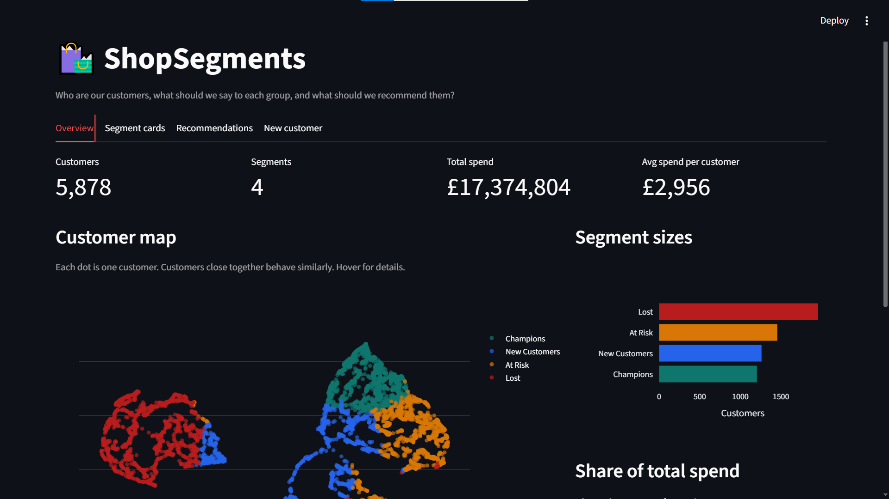

# ShopSegments: Customer Segmentation and Product Recommender

Segment e-commerce customers by behaviour (RFM + K-Means) and recommend products to each customer (ALS collaborative filtering), served through a Streamlit dashboard a marketing team can use.

- **Live demo:** [`<add Streamlit Cloud URL>`](https://shopsegments---customer-segmentation---appuct-recommender-bjeq.streamlit.app/)
- **Repository:** [`<add GitHub URL>`](https://github.com/AzlanFaisalRaj/ShopSegments---Customer-Segmentation---Product-Recommender.git)

## Problem

Online stores often send the same promotion to every customer, which wastes budget. ShopSegments answers two questions:

1. Which groups of customers do we have, and what should we say to each group?
2. Which products should we recommend to a given customer (including customers with no history)?

## Dataset

[Online Retail II](https://archive.ics.uci.edu/dataset/502/online+retail+ii) (UCI Machine Learning Repository): transactions of a UK-based online gift retailer, 1 Dec 2009 to 9 Dec 2011, 1,067,371 rows across two sheets.

## What the dashboard does

| Tab | Content |
|---|---|
| Overview | Customer and spend KPIs, interactive 2D customer map (UMAP + Plotly), segment sizes and share of spend |
| Segment cards | Per segment: size, average spend, orders, days since last purchase, top products, suggested marketing action |
| Recommendations | Top-10 products for a selected customer; "customers who bought this also bought" for a selected product |
| New customer | Popularity-based recommendations for customers with no history, plus a small tool that assigns a segment from Recency / Frequency / Monetary |

Screenshots: 

## Approach

### 1. Cleaning

| Step | Rows after | Rows removed |
|---|---|---|
| Raw (both sheets) | 1,067,371 | |
| Exact duplicates (sheets overlap on 1-9 Dec 2010) | 1,033,036 | 34,335 |
| Missing Customer ID | 797,885 | 235,151 |
| Cancelled invoices (prefix `C`) | 779,495 | 18,390 |
| Quantity <= 0 or Price <= 0 | 779,425 | 70 |

Result: 779,425 transactions from **5,878 customers**. Non-product codes (`POST`, `M`, `ADJUST`, `BANK CHARGES`, ...) are 1.8% of spend; they stay in RFM (they are real spend) and are excluded from the recommender.

### 2. RFM features

- **Recency:** days from the customer's last purchase to the snapshot date (last transaction date + 1 day).
- **Frequency:** number of distinct invoices.
- **Monetary:** total spend in GBP.

All three are heavily right-skewed (skewness 0.9, 12.6, 25.1), so features are transformed with `log1p` and standardised before clustering.

### 3. Segmentation

**Choosing k.** K-Means with k = 2 to 8:

| k | Inertia | Silhouette |
|---|---|---|
| 2 | 8577 | 0.439 |
| 3 | 6337 | 0.348 |
| **4** | **4895** | **0.366** |
| 5 | 4070 | 0.344 |
| 6 | 3535 | 0.335 |
| 7 | 3171 | 0.303 |
| 8 | 2883 | 0.296 |

Silhouette is highest at k = 2, but two clusters only separate active from inactive customers, which is not actionable for marketing. Among k >= 3, **k = 4 has the best silhouette** and the elbow curve bends gradually without a sharp elbow. Four segments also map to four distinct marketing actions, so k = 4 was chosen on both statistical and business grounds.

**Model comparison** (same scaled data):

| Model | Clusters | Noise | Silhouette |
|---|---|---|---|
| K-Means (k=4) | 4 | 0% | 0.366 |
| Gaussian Mixture (k=4) | 4 | 0% | 0.223 |
| DBSCAN (eps=0.3, min_samples=10) | 3 | 5.8% | 0.162 |
| DBSCAN (eps=0.4, min_samples=10) | 2 | 2.5% | 0.281 |
| DBSCAN (eps=0.5, min_samples=10) | 2 | 1.4% | 0.278 |

K-Means gives the best usable result. DBSCAN finds only 2 to 3 dense regions plus noise because RFM data is one continuous cloud, and the Gaussian Mixture scores lower.

**Segments.** Names are assigned by rules from cluster means (not hard-coded labels), so they stay correct if cluster order changes.

| Segment | Customers | Avg days since last purchase | Avg orders | Avg spend (GBP) | Share of customers | Share of spend |
|---|---|---|---|---|---|---|
| Champions | 1,204 | 28 | 19.2 | 10,678 | 20.5% | 74.0% |
| New Customers | 1,261 | 29 | 3.0 | 848 | 21.5% | 6.2% |
| At Risk | 1,455 | 231 | 5.0 | 1,945 | 24.8% | 16.3% |
| Lost | 1,958 | 398 | 1.4 | 316 | 33.3% | 3.6% |

Champions are 20% of customers and 74% of spend. UMAP is used for the 2D map only, not for clustering.

### 4. Recommender

- **Interaction matrix:** customers x products, binary (bought / not bought). Raw quantity was not used because single orders reach 80,995 units and dominate the model.
- **ALS** (`implicit`, 64 factors) for personalised top-10 and similar products.
- **Item-based CF** (item-item cosine similarity) as a comparison.
- **Cold start:** unknown customers get the 10 products bought by the most distinct customers.

**Offline evaluation.** Time-based hold-out: train on everything before the last 90 days, test on purchases in the last 90 days (2,286 customers with history and test purchases; 4,443 products).

| Model | Precision@10 | Recall@10 | Coverage |
|---|---|---|---|
| Popularity (baseline) | 0.104 | 0.035 | 0.2% |
| Item-based CF | 0.059 | 0.021 | 19.0% |
| **ALS** | **0.112** | **0.069** | **41.4%** |

ALS is only slightly more precise than the popularity baseline, but it doubles recall and covers far more of the catalogue (popularity recommends the same ~10 items to everyone). Already-purchased items are not filtered out because repeat buying is common in this data: filtering them halved Precision@10 in testing.

## Project structure

```
shopsegments/
├── app/streamlit_app.py        # dashboard
├── src/
│   ├── data_prep.py            # load, clean, RFM
│   ├── segmentation.py         # scaling, k selection, model comparison, naming, UMAP
│   ├── recommender.py          # matrix, ALS, item-CF, cold start, Recommender class
│   ├── evaluate.py             # time split, Precision@K, Recall@K, coverage
│   └── run_pipeline.py         # Excel -> models/ and reports/
├── notebooks/                  # EDA and modelling notebooks
├── models/                     # saved artifacts used by the app
├── reports/                    # CSV tables from the last pipeline run
├── requirements.txt            # dashboard dependencies
└── requirements-dev.txt        # full pipeline dependencies
```

## How to run

**Dashboard only** (uses the saved files in `models/`):

```bash
pip install -r requirements.txt
streamlit run app/streamlit_app.py
```

**Full pipeline** (download `online_retail_II.xlsx` from UCI into `data/raw/` first; takes a few minutes):

```bash
pip install -r requirements-dev.txt
python -m src.run_pipeline --excel data/raw/online_retail_II.xlsx
```

This regenerates `models/`, `data/processed/` and `reports/`.

## Limitations

- **22% of rows have no Customer ID** and were dropped. Segments describe registered customers only; guest checkouts are not covered.
- **Old, single-retailer data** (UK gift wholesaler, 2009-2011, 92% of rows from the UK). Segment sizes and thresholds will not transfer to another store without retraining.
- **Silhouette is moderate (0.37).** RFM data is one continuous cloud, so segment borders are fuzzy; k = 4 is a business-driven choice, not a clean natural split.
- **ALS barely beats popularity on Precision@10.** The gain is in recall and catalogue coverage. One 90-day hold-out was used; no cross-validation or confidence intervals.
- **Offline metrics only.** No A/B test, so the effect on real sales is unknown.
- **Cold start is popularity only.** New customers get the same list; there is no use of country or first-basket information.
- **Segments are a snapshot.** Movement between segments over time is not modelled.
- Recommendations are not filtered by stock, price or seasonality.

## Tech stack

Python, pandas, scikit-learn, UMAP, Plotly, implicit (ALS), SciPy, Streamlit.

## Author

Muhammad Azlan, built as the Week 3 project of the DawoodTech ML internship.
